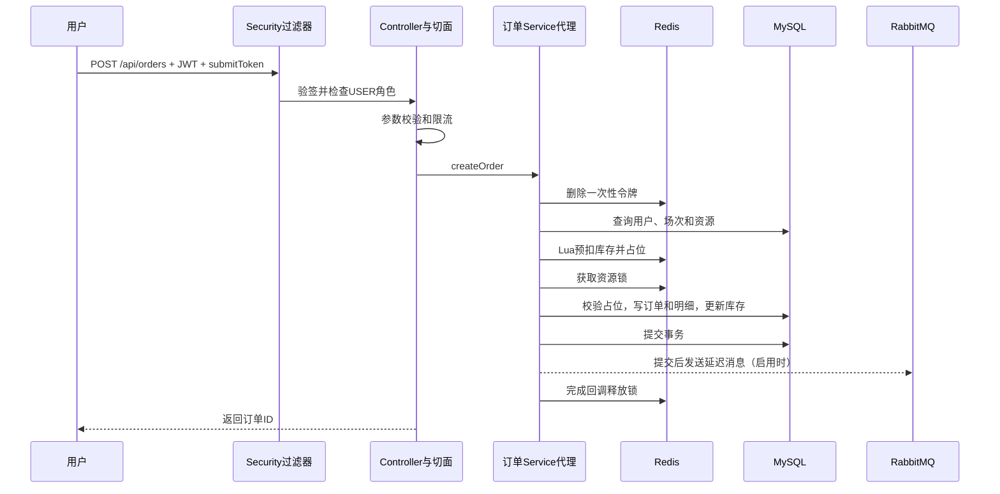

# 01 结构与请求链路

## 项目的真实形态

VenuePass 当前是一个 Spring Boot 单体后端。一个 Java 进程对外提供 HTTP 接口和 WebSocket，依赖 MySQL、Redis，可选连接 RabbitMQ。引入分布式锁不等于已经完成微服务架构，也不等于经过多实例压测。

| 技术 | 当前配置或依赖 | 承担的工作 |
|---|---|---|
| Java | 21 | 语言与运行时 |
| Spring Boot | 3.3.5 | 自动配置、嵌入式 Web 容器、配置绑定 |
| Spring MVC / Validation | 由 Boot 管理 | JSON 参数、路由、入参校验 |
| MyBatis-Plus | 3.5.7 | ORM 辅助、条件构造器、分页 |
| MySQL | 本地要求 8+，Compose 为 8.4 | 核心业务事实和唯一约束 |
| Redis | 本地要求 7+，Compose 为 7.4 | 令牌、计数、缓存、库存预扣、榜单 |
| Redisson | 3.32.0 | Redis 分布式锁客户端 |
| RabbitMQ | Compose 为 3.13-management | TTL + DLX 延迟关单 |
| Spring Security / JJWT | JJWT 0.12.6 | 认证、路由角色规则、JWT 签名验签 |
| AOP / WebSocket / POI | POI 5.2.5 | 横切逻辑、通知、Excel 导出 |
| Knife4j | 4.5.0 | OpenAPI 接口调试页面 |

版本依据 [pom.xml](../../pom.xml)、[应用配置](../../src/main/resources/application.yml) 和 [Compose](../../docker-compose.yml)。不把 Spring 最新参考文档中的 7.x 专属特性套到本项目。

## 目录不是背诵题，要说明职责

```text
src/main/java/com/jxbg/ticket/
  controller/  HTTP 协议适配：入参、登录上下文、返回结构
  service/     业务接口与状态校验
  service/impl/业务编排、事务、缓存和中间件调用
  mapper/      MyBatis-Plus 数据访问及定制 SQL
  entity/      数据表映射
  dto/         接口请求对象
  vo/          面向调用方的响应对象
  security/    JWT、身份和认证过滤器
  config/      安全链、Redis 锁、分页、MQ、WebSocket 配置
  aspect/      操作日志与限流的环绕通知
  annotation/  对应自定义注解
  mq/          延迟消息发送和消费
  job/         定时扫描超时订单
  common/      统一返回、分页、基础字段、日志上下文
  exception/   异常和全局处理
  enums/       订单、角色、核销等枚举
src/main/resources/db/  表结构与演示数据
docs/                  原有接口说明和本学习手册
```

Controller 不一定都很薄：当前 [CheckinController](../../src/main/java/com/jxbg/ticket/controller/CheckinController.java) 直接编排核销事务。这是当前实现；可讨论把它下沉到 Service 的可测试性收益，不能说已经全部做到严格分层。

## 一次创建订单请求



该图说明正常顺序，不表示 Redis 与 MySQL 同时原子提交。事务开始发生在进入 Service 代理时，图中没有画出连接池借还、每条 SQL 和所有事务回调。

阅读入口：[ReservationOrderController](../../src/main/java/com/jxbg/ticket/controller/ReservationOrderController.java)、[ReservationOrderServiceImpl](../../src/main/java/com/jxbg/ticket/service/impl/ReservationOrderServiceImpl.java)。注意源码先做 Lua，再获取座位锁；不要背成“先加锁再执行 Lua”。

## DTO、Entity、VO 为什么分开

请求对象约束调用者能输入什么；Entity 对应数据库；VO 决定对外展示什么。复用 Entity 做写接口时，要防止调用者提交 `id`、`deleted`、状态或归属字段。当前部分维护接口仍直接接收 Entity，这是后续可收敛的边界，并非项目已经完全消除了过度绑定风险。

示例：创建订单传 `sessionId` 和 `seatIds`，响应先给订单 ID；订单详情再组合订单与资源快照。这样不会要求客户端理解所有数据库字段。

## 框架背后的思想

IoC 是由容器管理对象及依赖，构造器注入让依赖显式；`@RequiredArgsConstructor` 为 `final` 字段生成构造器。单例 Service 可能被多个请求线程同时调用，请求临时数据要放局部变量，不能放可变成员字段。

Spring Boot 的自动配置依赖 classpath、配置项和条件 Bean。这里的 `@ConditionalOnProperty` 决定 RabbitMQ 生产者/消费者是否创建。可替换接口 `OrderTimeoutMessageProducer` 让订单业务不用到处写 MQ 开关判断，体现“针对接口编程”和把变化隔离到边界。

## 自己完成的练习

不看目录回答：JSON 在哪转换？JWT 在哪验签？Controller 校验失败是否进入 Service？事务在哪开始？异常由哪一层变成响应？为什么 Filter 中的异常不一定交给 MVC 的全局异常处理？

对应题：Q001、Q005、Q006、Q007、Q072。原理参见 [S01、S04、S12](sources.md)。
