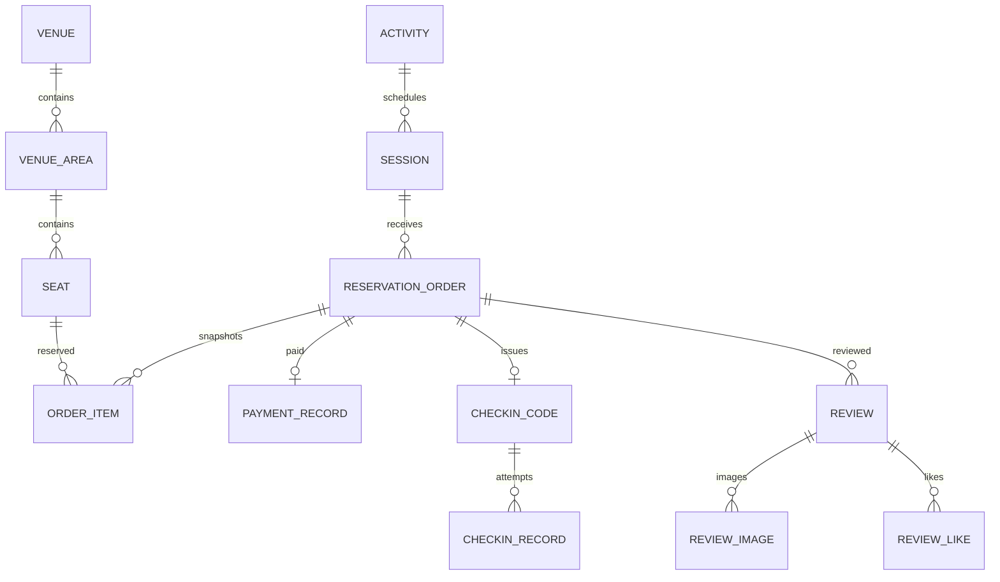
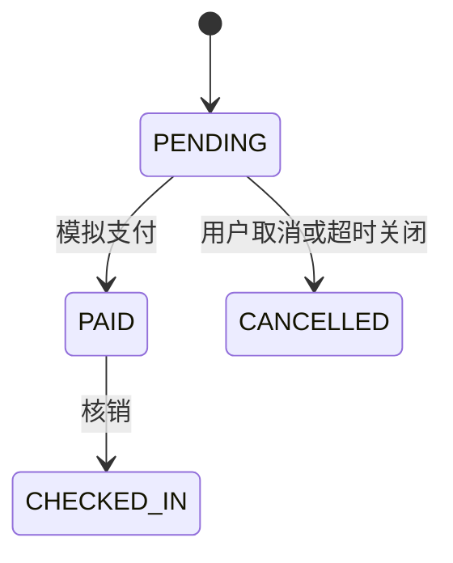

# 02 业务建模与数据约束

## 先解释“预约的到底是什么”

`venue` 是场馆，`venue_area` 是馆内区域，`seat` 是可预约资源的统一抽象，可以是一张座位、一块球场或一个房间。资源名称是 seat，不代表所有资源都是物理椅子。

`activity` 是预约项目或活动；`session` 是某活动在某馆的一个场次，含开始、结束时间和库存。创建订单用 `sessionId` 指明场次，`seatIds` 指明本次选择的资源，不再单独提交任意开始/结束时间。

当前“同一资源不能重复预约”的唯一性范围是 `sessionId + seatId`。不同 session 即使时间重叠，也不会因这条唯一索引自动冲突。若未来支持任意时间段，需要判断区间重叠 `existing.start < new.end AND existing.end > new.start`，并为判定与写入建立共同的并发控制边界。

另一个实际边界：当前资源查询和下单主要校验场馆归属，尚未完整建立“场次只允许某活动/区域资源”的关联约束。因此 session 不是天然正确的“某时间段所有合法资源集合”。具体看 [SessionSeatController](../../src/main/java/com/jxbg/ticket/controller/SessionSeatController.java) 和 `createOrder`。

## 关系与事实归属



图表示业务关系，不表示 SQL 已创建外键。`schema.sql` 主要使用普通字段、索引和应用校验，并未为这些关系统一声明外键。

## 哪些字段是快照

`order_item.seat_no`、`order_item.price`、`reservation_order.total_amount` 保存下单时的业务事实。资源改名或调价后，历史订单不应被新价格重算。金额用 `DECIMAL` 和 `BigDecimal`，舍入与退款规则需要显式定义。

`price_rule` 有表和管理接口，但当前创建订单主要累加 `Seat.basePrice`，不能说“已经实现完整的按场次动态定价”。题库 Q004、Q070 会追问这点。

## 一个资源的库存为什么还是一个数量

某场次拥有多个可预约资源，总库存与单个资源的可用性是两个维度。`available_stock` 限制场次还可接受多少资源；有效 `order_item` 判断具体哪个资源被占用。只检查数量会把已订的座位再次卖出；只检查座位而不检查场次容量，也可能违反容量限制。

示例场次初始库存 2，同时允许看到 4 个同馆资源，说明容量设置与资源绑定并非天然一致。必须先确定业务规则，再决定库存初始化取容量还是取关联资源数量。

## 为什么 active_flag 取消后设 NULL

[schema.sql](../../src/main/resources/db/schema.sql) 定义：

```sql
UNIQUE KEY uk_item_session_seat_active (session_id, seat_id, active_flag)
```

有效占用 `active_flag=1`：同场次同资源只允许一条。释放后设 `NULL`：MySQL 的 UNIQUE 索引允许多个含 NULL 的记录，从而保留多次历史预约。

若用 0 表示所有已释放记录，第二次释放后可能再次碰撞 `(session_id, seat_id, 0)`。`NULL` 也不等于 0；SQL 判断要用 `IS NULL`，不能用 `= NULL`。

点评与点赞采用类似设计：`uk_review_order_active` 和 `uk_review_like_active` 限制有效记录。这是利用数据库语义表达业务约束，应用中的“先查一下”只能提供友好错误，不能替代最终约束。[S07](sources.md)

## 状态机与并发要分开看



[OrderStateMachine](../../src/main/java/com/jxbg/ticket/service/OrderStateMachine.java) 校验允许的状态流转，但 Java 中检查合法状态之后，数据库状态仍可能被另一请求修改。严谨的实现还要条件写入，并检查影响行数：

```sql
-- 改进示例，不是当前所有支付/取消接口都已使用的 SQL
UPDATE reservation_order
SET status = 'PAID', paid_at = NOW()
WHERE id = ? AND status = 'PENDING' AND expire_time > NOW();
```

影响 1 行代表抢到状态迁移资格；0 行需要重新读取并判断是已支付、已取消还是不存在。只有取得资格的一方能触发流水、释放库存、通知等副作用。

## 为什么付款和订单分表

订单描述预约意图与履约状态，支付记录描述资金动作。当前 `payment_record` 一订单一成功记录，属于模拟支付的简化模型。真实支付通常还涉及多次尝试、渠道流水、回调验签、金额校验、退款和对账，不能把现有表直接当完整支付中心。

## 练习与验收

画出一次创建、取消、再预约后 `order_item` 的三条历史记录。说明哪些记录需要排他、哪些可以重复。再推演一个场次库存为 2、资源列表有 4 个时，应怎样定义允许预约的范围。

对应 Q002、Q003、Q004、Q011、Q013、Q070；实验 L01、L03。返回 [目录](README.md)。
