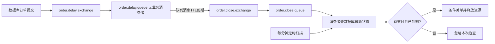

# 07 RabbitMQ 与定时任务

## 消息承载的是待处理事件的线索

订单创建提交后发送字符串 orderId。消息不需要携带某个旧时刻的支付结果；消费者到期查询最新数据库状态，决定是否关闭。MQ 在这里用于安排未来检查，不是让 Java 请求线程睡 15 分钟。

源码入口：[OrderTimeoutRabbitConfig](../../src/main/java/com/jxbg/ticket/config/OrderTimeoutRabbitConfig.java)、[生产者](../../src/main/java/com/jxbg/ticket/mq/RabbitOrderTimeoutMessageProducer.java)、[消费者](../../src/main/java/com/jxbg/ticket/mq/OrderTimeoutMessageConsumer.java)、[定时任务](../../src/main/java/com/jxbg/ticket/job/OrderTimeoutJob.java)。

## TTL + DLX 的机制

队列设置 `x-message-ttl`，过期消息由死信交换机和 routing key 转发到关单队列。延迟队列没有业务消费者；关单队列才有监听方法。过期不是客户端主动拉取，也不是消息凭空消失后被消费者“查到”。[S14、S15](sources.md)

当前使用统一的队列级 TTL，而不是给每条订单消息设置不同 TTL。调整既有队列的声明参数可能产生 `PRECONDITION_FAILED`；已有消息的到期设计也不能靠改应用配置随意重算。应使用迁移策略或新队列，不要直接删除生产队列。

TTL 是触发资格，不保证在某一毫秒精确执行。队列处理、网络和消费积压会带来延迟；混用不同消息 TTL 还可能有队头阻塞。无论哪种方案，消费者仍需检查真实 `expire_time`。

## 可靠性需要拆成三段

| 环节 | 要回答的问题 | 当前与改进 |
|---|---|---|
| 应用到 broker | broker 接收了没有？路由成功没有？ | 当前 convertAndSend，未显式配置完整 confirms/returns 处理 |
| broker 内部 | 队列和消息能否经受故障？ | durable 队列只是基础，还需确认消息持久属性、队列类型及副本 |
| broker 到业务 | 消费成功如何确认？失败如何重试？ | 当前没有手写 ACK，使用容器默认自动确认语义；失败重试/隔离未完整配置 |

消费者自动确认的含义要结合 Spring AMQP 容器：通常在监听方法成功完成后确认，不等于业务代码显式手动 ACK，也不要混成 RabbitMQ 协议的无确认模式。

Publisher confirm 表示 broker 对发布的确认，consumer ACK 表示消费者处理结果，两者不是同一个确认。持久队列、持久消息、confirm、业务幂等分别解决不同故障窗口，不能互相替代。[S16](sources.md)

## afterCommit 为什么还不等于可靠投递

提交后再发消息，能避免消费者先于订单提交。可是 DB 提交成功到发送之间应用可能退出，或者网络超时导致不知道 broker 是否收到。当前发送异常会记录日志，定时扫描负责让超时订单最终有机会被处理。

Outbox 方案是同事务写订单与待发送事件，再由任务重试发送。消费者还要容忍重复，事件处理成功后再确认。不存在一句“Exactly Once 配置”就能消除所有跨系统失败。

## 重复消费与并发关单

当前关单 `UPDATE ... WHERE id=? AND status='PENDING'`，更新失败不继续释放资源，防止两个关单消费者都赢得同一状态迁移。Redis 释放脚本也按实际移除数量回补，形成一定防重。

但不同订单共同回补场次数据库库存仍有读改写风险，支付竞争也需共同约束。不要仅凭关单 CAS 就宣称所有订单并发路径已经正确。详见 B02、B03。

## 定时任务、多实例和积压

`@Scheduled` 在每个应用实例都会执行，不具备天然集群唯一调度。可以通过条件更新、任务锁、分片等协调；XXL-JOB 是备选调度平台，项目没有集成。

当前每分钟扫描最多 50 条，粗略意味着常规任务每分钟最多处理一个批次。实际还受查询和事务耗时影响，不能把它当高精度容量保证。积压时应观察最老未支付订单延迟、批次耗时、DB 锁等待、消费者异常率与消息队列 ready/unacked，而不只是“队列里有多少条”。

订单扫描查询按状态、到期时间筛选；现有索引不等于已经最佳匹配，需用真实数据做 EXPLAIN，再评估 `(status, expire_time, id)` 等候选索引。不要不看执行计划就上线新索引。

## 如何严谨介绍当前进度

“代码实现了 TTL + DLX 关单，并保留定时扫描补偿。当前默认关闭 MQ。真实 broker 的投递、过期、重复消费和异常恢复需要按 L07 留下联调记录，不能只根据编译通过说可靠性已验证。”

对应 Q041-Q047；实验 L07。返回 [目录](README.md)。
